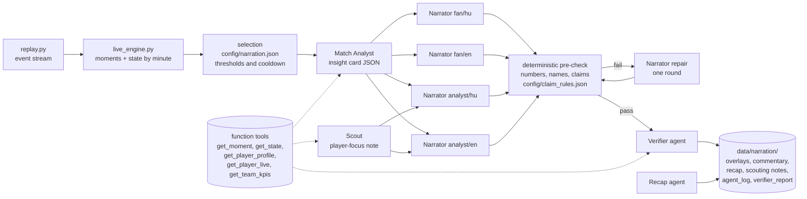

# Scout's Eye – Explainable U19 Match Intelligence

> **▶ Live demo: https://calm-pond-0e514280f.3.azurestaticapps.net** · one-page summary: [docs/one_pager.pdf](docs/one_pager.pdf) · demo video script and subtitles: `video/`

Author: **Laczkovics Martin** (GitHub: [laczmartin](https://github.com/laczmartin)) · MIT licence

A fully synthetic, football-realistic U19 mini-tournament, an explainable KPI
and player-profile layer, and **multi-agent live narration on Microsoft
Foundry** (Microsoft Agent Framework) whose every number is traceable to an
event id and whose every sentence passes a deterministic pre-check and a
Verifier agent. A static web UI (`site/`) makes the agents' collaboration
visible: roles, shared state, handoffs, repairs and rejections. Every agent
call has a time limit and retries; a step that still fails is isolated and the
deterministic fact card stays on screen (see "Failure recovery").

**Data statement.** All data is synthetic: teams, players, dates, the venue
and every event are generated by the code in this repository. No real match
data, footage or provider data is included. During development the
generator's parameters were tuned so that team and match statistics look
plausible for U19 football. During early development, the generator was tuned
against private reference values (aggregate league averages), and earlier
versions of the validator used realism bands derived from them. Two generator
design ranges remain from that stage (goals per match 3.4–3.9, goals/xG
1.05–1.20). None of these values are part of this repository; the published
realism validation uses public sources only (see benchmarks.py). Those public
sources are listed there with links (UEFA Youth League goals per match, a
published U19 passing study and published U19 GPS studies); every other
statistic is reported without a target. The players are fictional minors, so the agents produce
football commentary only. No real league or club names, logos or trademarks
are used on purpose.

**Contents:** Phase 1 generator and validation · Phase 2 KPIs, profiles and
live engine · Phase 3 agents, verifier, batch / live / offline modes · Phase 4
web UI. A short guide to the UI is in `GUIDE.md` (English) and `SEGEDLET.md` (Hungarian).

## How to test (for judges, no Azure needed)

```bash
git clone https://github.com/laczmartin/scouts-eye.git && cd scouts-eye
python3 build_site.py                                  # exports the committed outputs into site/data/
python3 -m http.server 8765 --directory site           # open http://localhost:8765, press "Demo script"
python3 validate.py                                    # 19 consistency and rule checks on the synthetic data
python3 check_narration.py                             # 8 quality checks on the narration outputs
python3 run_agents.py --match M12 --mode offline --speed 60 --persona fan --lang hu   # replay the verified overlays
python3 evaluate_scouting.py                           # honest validation of the profiles against the hidden ground truth
python3 measure_factcards.py                           # fact-card latency on the live code path (no LLM)
python3 compare_agents.py                              # single agent vs five agents: re-scores the saved texts (no LLM)
python3 tests/test_checks.py                           # free test cases for every checker rule (no LLM)
python3 tests/test_event_metrics.py                    # pass difficulty, ball / shot speed, player tags (no LLM)
```

Everything above runs with the Python standard library (tested with Python 3.9.6 and 3.13.2
on macOS; the agents themselves need Python 3.10+). To
regenerate the data and KPIs: `python3 generate.py --seed 42 && python3
run_kpis.py --seed 42`. To run the agents yourself you need a Microsoft
Foundry project, `az login`, a `.env` from `.env.example` and the packages in
`requirements-agents.txt` (see "Agents" below); a full uncached M12 run costs
well under one US dollar with `gpt-4.1-mini`. The failure-recovery test needs
the packages of `requirements-agents.txt` but no Azure and no LLM (a fake model
injects the faults, about 5 seconds):
`python3 tests/test_failure_recovery.py`.

## Quick start (data generation)

No third-party packages are needed for Phases 1–2 (Python 3.10+ standard library only).

```bash
python generate.py --seed 42          # writes data/synthetic/
python validate.py                    # writes validation_report.md
python replay.py --match M12 --speed 60
python calibrate.py --matches 60      # optional: large-sample check against the published benchmarks
```

The same `--seed` always produces identical files (only the generation
timestamp in `generation_metadata.json` differs).

## Outputs (`data/synthetic/`)

| file | content |
|---|---|
| `teams.csv` | 4 teams: id, fictional name and city, formation, hidden strength, style parameters (possession, pressing, directness, each 0–1) |
| `players.csv` | 92 players (23 per team): id, fictional name, shirt number, birth date, age, position group and detail, primary and secondary position, preferred foot, height, squad role |
| `ground_truth_abilities.csv` | hidden 0–100 abilities per player, a `standout` flag and the secondary-position penalty. **Validation only – see below** |
| `matches.csv` | 12 matches: matchday, date, tournament day (1–16), neutral venue, home/away (nominal), score, `live_flag` (M12), stoppage time, duration |
| `events/M01.jsonl` … `events/M12.jsonl` | one JSON event per line (schema below) |
| `lineups.csv` | one row per squad player per match: status (`started`, `sub_in`, `rotated`, `suspended`, `injured`), position detail and position group actually played, on/off time in ms, minutes played, end reason |
| `physical_snapshots.csv` | per player per 5-minute window: distance, high-speed distance, sprint distance, sprints, top speed |
| `generation_metadata.json` | seed, version, timestamp, every simulation parameter, the injury log and the tournament rules |

### `ground_truth_abilities.csv` is not an input

This file is the hidden, fictional "truth" that the players were simulated
from. It is published on purpose, so that anyone can check the talent-finding
result. Exactly these scripts touch it:

| script | what it does with the file |
|---|---|
| `synth/tournament.py` | writes it (part of the generator) |
| `evaluate_scouting.py` | reads it to validate the profiles (`scouting_validation.md`) |
| `validate.py` | reads only the `standout` column, to find the four planted talents for the minutes check |
| `build_site.py` | reads it only to show the planted talents' "Validation" rank in the UI, clearly labelled as hidden ground truth |

No KPI, profile, live-engine or agent code reads it: `kpi/`, `run_kpis.py`,
`live_engine.py`, `agents/`, `run_agents.py` and `check_narration.py` never
open it, so the model's rankings and all narration are computed without it.
(`kpi/diagnostics.py`, used by `evaluate_scouting.py --diagnostics`, simulates
fresh squads and uses their abilities in memory; it does not read the file.)

## How the data is generated

### Teams and squads

* Four teams with hidden strengths close to each other (71, 70, 65, 66) so
  that results are plausible and the title stays open. One team (T4) is a
  "possession" profile (many short passes, little pressing), the other three
  are "direct/pressing" profiles with different pressing intensity. The four
  formations are 4-3-3, 4-2-3-1, 3-5-2 and 4-4-2.
* 23 players per team, with a composition that depends on the formation
  (calibrated on 23-man tournament squads):

  | team | formation | GK | CB | FB/WB | DM | CM | AM | W | ST |
  |---|---|---|---|---|---|---|---|---|---|
  | T1 | 4-3-3 | 3 | 4 | 4 | 2 | 4 | – | 4 | 2 |
  | T2 | 4-2-3-1 | 3 | 4 | 4 | 4 | – | 3 | 3 | 2 |
  | T3 | 3-5-2 | 3 | 5 | 4 (wing-backs) | 2 | 5 | – | – | 4 |
  | T4 | 4-4-2 | 3 | 4 | 4 | – | 5 | – | 4 (wide midfielders) | 3 |

  Every player's primary position exists as a slot in his team's formation
  (amendment of 22 Oct): the former AM players of T1, T3 and T4 are listed as
  CM or W, T2's central midfielders as DM (the double pivot) and T4's as CM.
  Names are random combinations from a pool of common first and last names
  from across Europe and beyond; any resemblance to a real person is
  coincidental.
* **Multi-positional players:** 2–4 per team have a `secondary_position`
  next to their `primary_position` (`position_group` equals the primary).
  Pairings are realistic (CB↔FB, CB↔DM, CM↔DM, AM↔W, W↔FB, W↔ST) and chosen so
  that both positions exist as slots in the team's formation; in T3 (3-5-2) no
  wing-back is a hybrid, so T3's hybrids come from CB↔FB, CB↔DM and CM↔DM.
* **Age rules (U19):** every player was born on or after 1 January 2008.
  `age` is year-based (tournament year minus birth year), as is customary in
  youth football: born 2008 = 18, 2009 = 17, 2010 = 16, 2011 = 15. Most players
  are 18, then 17; at most two 16-year-olds per team and at most two
  15-year-olds in the whole tournament. Birth months follow the relative age
  effect (about 35 % Q1, 28 % Q2, 22 % Q3, 15 % Q4).
* Preferred foot ~75 % right, ~22 % left, ~3 % both; heights realistic per
  position; squad role (starter / rotation / fringe) from ability rank within
  the position group.

### Hidden abilities

Ten abilities per player (passing, ball carrying, finishing, aerial, tackling,
positioning, pressing, decision making, pace, stamina) on 0–100. Each is a
position-specific mean, shifted by team strength and by age (older is slightly
better on average), plus a player-level talent term and per-ability noise. Each
Multi-positional players are slightly weaker in their secondary position: the
key abilities of that position carry a hidden penalty of 3–8 points, stored
only in the ground truth (`secondary_position`, `secondary_penalty`,
`secondary_key_abilities`) and used by the simulator when the player fills a
slot of the secondary group. Each
team gets three standouts: two older players and one **young hidden gem (age
15 or 16)** whose key abilities are boosted (finishing only mildly, to keep
goal tallies realistic). The gem is a rotation player with a planned set of
appearances: starts in two matches (taken off after about an hour) and comes
on as a substitute in three others, which gives at least 180 minutes. Gems are
never injured or booked, so they cannot drop out of the tournament, and each
gem is a genuine top-3 talent of his position by the hidden composite used in
the scouting validation (`GT_COMPOSITE` in `synth/config.py`).

### Match simulation (possession-chain model)

A match is a sequence of possessions; a possession is a chain of on-ball
actions. At every step the actor is chosen by proximity of their formation
"home position" to the ball, then one of pass / carry / dribble / shot /
clearance is chosen with probabilities that depend on pitch zone, team style
and game state (score, minute). Before each action the defending team may
apply **pressure**, which lowers success probabilities.

* **Passes:** short or long (long > 30 m, more likely for direct teams and from
  the own third). Success is a logistic function of the passer's passing and
  decision making, pressure, forward progression, pitch zone, team possession
  style and fatigue. Failed passes become interceptions, clearances, throw-ins
  or loose balls. High balls can trigger an **aerial duel**; a share of aerial
  duels are neutral (nobody wins), as in real data.
* **Carries** move the ball forward; a defender may challenge (a **tackle**
  for the defender, a ground duel for the carrier). Challenges are much more
  frequent close to the defender's own goal; in the opponent's half they scale
  with the team's pressing style.
* **Dribbles** (take-ons) are attacker-initiated duels against a nearby
  defender.
* **Shots** are taken in the final third with a probability that rises with
  closeness and with the location's xG. Hidden abilities shape the chance:
  receivers in the final third are chosen with a bias towards good positioning
  and finishing (who gets into shooting positions), decision making lowers the
  appetite for low-xG shots and raises it for high-xG ones (shot choice), a
  good finisher takes the shot from a slightly better spot (chance quality),
  and creative passers (passing + decision making) deliver final-third passes
  closer to goal and more centrally, which drives key passes and xA. **xG** is a logistic function of
  distance and goal-mouth angle, reduced for headers and under pressure
  (penalties fixed at 0.76, open-play capped at 0.65). Goal probability is xG
  times a small overperformance factor and a small finishing effect; otherwise
  the shot is saved, blocked or off target, calibrated to ~40 % on target.
* **Set pieces:** throw-ins, free kicks (direct shot possible near goal),
  corners (mostly high deliveries into an aerial duel), penalties (rare),
  kick-offs after goals and at the start of each half.
* **Fouls and cards:** fouls arise inside duels; a yellow card follows a foul
  with a probability that rises late in the match and near the fouling team's
  goal. A second yellow sends the player off and ends their lineup interval.
* **Time:** each event advances the clock by a type-specific random amount;
  stoppage time is 1–4 min (first half) and 2–6 min (second half).
  `minute`/`second` is the match clock (the second half starts at 45:00);
  `timestamp_ms` is cumulative playing time from kick-off and is what
  `replay.py` uses.
* **Line-ups, rotation and substitutions:** 11 starters per team chosen per
  formation slot from the available squad, weighted by squad role and by
  accumulated fatigue load (tired players rest). A slot can be filled by a
  player whose primary or secondary position matches it; the secondary option
  is used when the coach needs it (suspension, injury, rotation) and the plan
  makes sure every multi-positional player plays each of his two positions at
  least once in the tournament. Position changes happen only between matches:
  a substitute always takes the vacated slot, so a player has exactly one
  position per match (`position_detail` and `position_group_played` in
  `lineups.csv`). The first-choice goalkeeper
  always starts when available. Outfield players other than centre-backs may
  not start a third match in a row after two near-full matches (forced
  rotation), so only the goalkeeper and centre-backs can play every minute.
  Exactly 5 substitutions per match are planned in 3 windows (for example
  1 + 2 + 2 changes at about 58', 70' and 82'); the tired, booked or weaker
  starters go off first and substitutes are not taken off again.
* **Fatigue within and across matches:** after ~55 minutes on the pitch a
  player's success probabilities drop slightly, less so for high-stamina
  players. Minutes played add to a fatigue *load* that recovers only partly in
  the three days between matches (`load_recovery` = 0.45). Load brings the
  in-match fatigue onset forward, lowers the chance of being selected, and
  reduces the physical output (distance, high-speed running, top speed) in
  `physical_snapshots.csv`.
* **Cards, suspensions, sending-offs:** yellow cards follow fouls (more likely
  late and near the fouling team's goal, less likely for a player already
  booked). A second yellow or a straight red (serious foul play, rare) sends the
  player off; the team then plays with **ten men**: fewer passing options
  (pass success down), fewer shots, less pressing, and the opponent shoots
  more. Suspensions: two accumulated yellows = 1 match (the counter then
  resets), second yellow = 1 match, straight red = 2 matches.
* **Injuries:** random knocks, more likely when fatigued. A *minor* injury
  means the player is substituted (the injury substitution uses one of the
  three windows) and misses the next match; a *major* injury ends the
  player's tournament. The squad is fixed at 23, so nobody can be replaced.
  Injuries are `injury` events (outcome `minor` / `major`).
* **Game state:** a trailing team late in the match shoots more and plays more
  directly; a leading team presses less.
* **Availability in `lineups.csv`:** one row per squad player per match
  (23 per team) with `status` = `started`, `sub_in`, `rotated` (available but
  unused), `suspended` or `injured`, plus `end_reason` for players who were on
  the pitch (`full_time`, `substituted`, `injury`, `red_card`).

### Tournament structure and the title decider

Double round-robin, 6 matchdays × 2 matches, played every three days (days 1,
4, 7, 10, 13 and 16 of the tournament) at one neutral venue, so "home" and
"away" are only nominal. The two strongest teams meet in M01 and again in
**M12**, the designated live match. The whole tournament is simulated with a
seed derived from `--seed`, and re-drawn (with `seed * 7919 + attempt`) until
these acceptance criteria hold:

* M12 is a title decider: its two teams are 1st and 2nd after 11 matches, at
  most 3 points apart, and no other team can finish first;
* 2–3 draws in 12 matches;
* 3.4–3.9 goals per match on average, no match with more than 8 goals;
* tournament goals / xG between 1.05 and 1.20;
* the top scorer has 4–6 goals;
* at least one tournament-ending injury;
* every team's hidden gem plays 180–290 minutes.

These criteria are choices of the generator (a lively, plausible title
decider), not validation benchmarks. Two of them are the generator design
ranges named in the data statement (goals per match 3.4–3.9, goals/xG
1.05–1.20, which remain from the early stage tuned against private reference
values); the other
criteria are design choices. The validator checks only the published
benchmarks ("Realism: published benchmarks" below).

The accepted attempt index is stored in `generation_metadata.json`; the output
is still fully determined by the seed.

### Physical snapshots

Not derived from events. Per player per 5-minute window, built from
position-specific per-90 baselines (central midfielders cover the most ground,
wide players the most high-speed running), scaled by hidden stamina and pace,
with in-match fatigue, the accumulated load from previous matches and noise.
Thresholds follow the youth GPS literature:
high-speed running ≥ 19.8 km/h, sprinting ≥ 25.2 km/h. Players aged 15–16 have
lower top speeds by about 1.5 km/h.

## Event schema (`events/*.jsonl`)

Coordinates are always in the **acting team's attacking frame**: a 0–100 ×
0–100 pitch, attacking from left (x = 0) to right (x = 100). The pitch is
105 × 68 m, used for pass lengths.

| field | notes |
|---|---|
| `event_id` | `M07-00123`, unique across the dataset |
| `match_id`, `period`, `minute`, `second`, `timestamp_ms` | see "Time" above |
| `possession_id` | groups one possession chain |
| `team_id`, `player_id` | actor (`player_id` is null for `possession_change`) |
| `type` | `pass, carry, shot, tackle, interception, clearance, ground_duel, aerial_duel, pressure, ball_recovery, dribble, foul, card, save, offside, corner, free_kick, throw_in, kickoff, substitution, possession_change, injury` |
| `outcome` | `success` / `fail`; shots: `goal`, `saved`, `blocked`, `off_target`; cards: `yellow`, `red`; injuries: `minor`, `major` |
| `x`, `y`, `end_x`, `end_y` | start location; end location for pass, carry, dribble, shot, clearance, corner, throw-in, free kick |
| `pass_length_m`, `pass_height` (`ground`/`low`/`high`), `body_part`, `recipient_id`, `ball_speed_kmh` | pass-like events; `ball_speed_kmh` also for shots (60–110) |
| `under_pressure` | true when an opponent applied pressure just before the action |
| `xg` | shots only |
| `related_event_id` | links tackle ↔ ground duel, dribble ↔ ground duel, both aerial duels, foul ↔ card / free kick, shot ↔ save / block, pass ↔ interception / offside |
| `duel_role` | `offensive` / `defensive` on duel-type events |
| `card_type` | `yellow`, `second_yellow` or `straight_red` |
| `is_penalty` | true on the penalty kick (`free_kick` at the spot) and the penalty shot |
| `sub_player_in_id` | on `substitution` events (`player_id` is the player going off) |
| `score_home`, `score_away` | score after the event |

Goals are shots with `outcome = goal`.

## Metric definitions (common event-data conventions where possible)

These are the definitions used by `validate.py` and should be reused by the
KPI layer so that numbers are comparable to what scouts are used to.

| metric | definition |
|---|---|
| passes | events of type `pass` (corners, throw-ins and free kicks are separate types and are **not** counted as passes) |
| pass accuracy | successful passes / passes |
| long pass | pass with `pass_length_m` > 30 |
| defensive duel | a `tackle` (defender-initiated challenge) or a `ground_duel` with `duel_role = defensive` (the defender's side of a take-on). Won = `outcome = success` |
| ground duel contest | one per `tackle` or `dribble` event (each contest counted once) |
| aerial duel | every `aerial_duel` event; one contest produces one event per player. Won = `success`; about 10 % of contests are neutral, so the won share is below 50 % |
| interception | `interception` events (broad: any failed opponent pass picked up by a defender) |
| PPDA | opponent passes started in the opponent's own half ÷ our defensive actions (tackles, defensive ground duels, interceptions, fouls) in the opponent's half. Lower = more pressing |
| shots on target | `goal` + `saved` |
| xG | sum of `xg` over shots |
| possession share | our on-ball actions (pass, carry, dribble, shot) / both teams' on-ball actions |
| corners, fouls, yellow cards | counts of the respective event types (`card` with `card_type = yellow`) |
| physical per 90 | window totals of a player in a match, scaled to 90 minutes; players with ≥ 60 minutes |

## Validation

`validate.py` checks consistency (scores vs goal events, every event's player
on the pitch, lineup minutes vs substitutions, unique ids, monotonic
timestamps, coordinates in the pitch), the tournament rules (suspended and
injured players do not play, recomputed from card and injury events; ten men
after a red card; at most 5 substitutions in 3 windows; rotation; age
composition; top scorer 4–6 goals; hidden-gem minutes; squad composition
per team; 2–4 multi-positional players per team who each played both
positions; one position per player per match), compares the data with the
published benchmarks below, reports all other statistics without a target, and
writes a tournament summary to `validation_report.md`. Which scripts read
`ground_truth_abilities.csv` is listed in the section about that file above.

### Realism: published benchmarks

`benchmarks.py` holds the only realism targets, each from a public, published
source (links are also printed in `validation_report.md`):

| benchmark | value | source |
|---|---|---|
| goals per match | 2.93–3.44 (four seasons) | UEFA Youth League 2013–14, 2019–20, 2022–23, 2023–24 (season statistics on Wikipedia) |
| passes per team per match | 332 ± 49 (assumed per team per match) | Šrámková (2024), Charles University bachelor's thesis on six domestic U19 leagues, 2023/24 ([record](https://dspace.cuni.cz/handle/20.500.11956/192576)); the full text could not be checked, so the per-team-per-match reading is an assumption |
| total distance per outfield player | about 9–12 km per match | review in *The Sport Journal* on youth match running performance ([article](https://thesportjournal.org/article/physical-performance-of-youth-football-soccer-players-playing-in-european-and-national-leagues-matches/)) |
| position with the most distance | central midfield | Čaušević et al. (2025), *Sensors* 25(18) 5825, U19 GPS study ([article](https://www.mdpi.com/1424-8220/25/18/5825)) |
| position with the most high-speed running (≥ 19.8 km/h) | full-back or winger | Čaušević et al. (2025); U19 10 Hz GPS study ([IRIS UniSR](https://iris.unisr.it/handle/20.500.11768/103759)) |

The speed thresholds of the physical snapshots (high-speed running ≥ 19.8 km/h,
sprinting ≥ 25.2 km/h) follow Čaušević et al. (2025). For a tournament mean
(goals per match) the report also shows a **12-match band**: the benchmark
widened by one standard error of the mean, computed from the 12 synthetic
matches. With seed 42 all five benchmarks are OK; the goals-per-match mean
(3.67) is above the published range but inside the 12-match band.

All other statistics (pass accuracy, shots, xG, duels, PPDA, corners, fouls,
cards, pressures, physical details …) are **descriptive only**: they are
listed in the report without a target, because no public benchmark is used
for them. `calibrate.py` simulates many matches (default 60) and prints the
same benchmark checks plus the descriptive values.

## Project layout

```
generate.py            entry point: --seed, --out
validate.py            consistency + realism checks -> validation_report.md
replay.py              live replay of a match (stdout or HTTP POST), --speed
calibrate.py           large-sample check against the published benchmarks (plus descriptive values)
benchmarks.py          the published benchmarks and their sources
synth/config.py        every tunable parameter (team profiles, formations, ability means, simulation)
synth/names.py         fictional name pools and team names
synth/squads.py        teams, players, hidden abilities
synth/simulator.py     possession-chain match simulator
synth/physical.py      physical snapshots
synth/tournament.py    fixtures, acceptance loop, output writing
data/synthetic/        generated dataset
```

## Phase 2 – KPI and player-profile layer

```bash
python run_kpis.py --seed 42            # reference pool (seeds 1000-1049), baseline, live M12, final
python run_kpis.py --skip-reference     # reuse the existing reference pool
python evaluate_scouting.py --diagnostics   # validation against the hidden ground truth -> scouting_validation.md
python replay.py --match M12 --speed 60 | python live_engine.py --stdin   # live moments on stdout
```

* `kpi/accumulator.py` turns events into per-player and per-team counters
  event by event (key passes, assists, xA, progressive actions, xG build-up,
  pressure regains, PAdj ...), so the batch pipeline and the live engine share
  one implementation. Every formula is in [docs/kpi_definitions.md](docs/kpi_definitions.md).
* `kpi/aggregate.py`: per-90 and ratio KPIs per position played, shrinkage
  towards the reference-pool mean (k = 270 min), percentiles by position group,
  11 category scores, the position score with the public weights in
  `config/position_weights.json`, strengths / weaknesses and reliability labels.
* `data/reference/`: 50 extra fictional tournaments reduced to per-player,
  per-position raw per-90 KPIs (≥ 180 min), with seeds and date in the metadata.
* Outputs in `data/kpi/` (baseline M01–M11), `data/kpi/final/` (M01–M12) and
  `data/kpi/live/` (M12 moments feed and minute-by-minute state).
* `live_engine.py`: `update(state, event)` with rolling 5- and 15-minute team
  KPIs, control-vs-chaos index, momentum, live player KPIs with a
  low-reliability live position score, a moments feed with evidence event ids
  and importance, and a snapshot every minute. It reads replay output from
  stdin or via HTTP POST, or runs offline.
* `evaluate_scouting.py` compares the position scores with the hidden ground
  truth (Spearman per position, hidden talents, reliability, multi-positional
  players) and writes `scouting_validation.md`. Weights are not tuned to it.
* Nothing in `kpi/`, `run_kpis.py` or `live_engine.py` reads
  `ground_truth_abilities.csv`.

## Agents (Phase 3) – multi-agent narration on Microsoft Foundry

The deterministic facts of Phase 2 are turned into timed, personalised,
verified narratives. Agents never invent numbers: every output carries the
`evidence_event_ids` and `source_fields` it rests on, and every text passes a
deterministic pre-check and a Verifier agent before it is written out.



### Agents and their roles

| agent | input | output |
|---|---|---|
| **Match Analyst** | one moment (or a state snapshot) plus the live state window and the last important moments | a structured insight card: type, headline facts, why it matters (control vs chaos, pressure, rhythm), the numbers used with their field names, evidence event ids |
| **Scout** | baseline profile + live KPIs of the focus player | a cautious player-focus note with the reliability label, minutes and a low-data warning below 180 tournament / 20 live minutes |
| **Narrator** | insight card (+ scout note) × persona × language × club view / focus | overlay (≤ 90 characters), commentary (≤ 2 sentences), optional detail, written natively in the language |
| **Verifier** | narrator text, the facts, the pre-check findings | verdict ok / repaired / reject with reasons; repairs numbers, names and unsupported claims |
| **Recap** | match facts, verified cards, team KPIs, final profiles | post-match recap (fan + analyst, hu + en), top 3 moments, scouting notes on the young players and the top 3 per position |

**Deterministic pre-check** (`agents/verify.py`, before the Verifier LLM): every
number in the text must appear in the facts given to the narrator (tolerance
6 % / 0.6), every player name must be a fact name, the overlay must fit 90
characters, and every **professional claim** matched by `config/claim_rules.json`
must be backed by facts of the state window or a moment:

| claim | needs |
|---|---|
| dominates / controls the match | field tilt ≥ 58 % or possession ≥ 58 % in the 15-minute window, or momentum ≥ 0.25 for that team |
| high press / keeps them under pressure | PPDA ≤ 8 in the 15-minute window, or a pressing-surge moment in the last 5 minutes |
| chaotic / open / end-to-end | regime "chaos" or control index < −0.15 |
| controlled / patient game | regime "control" or control index > 0.15 |
| turnaround / momentum has swung | a momentum-shift moment in the last 3 minutes |
| best / outstanding in his position | position score or a category percentile ≥ 75 **and** ≥ 180 tournament minutes; below that only with explicit low-data wording |

A failed pre-check goes back to the Narrator once with the reasons; if it fails
again the text is dropped and logged, and the fact card stays (see "Failure recovery"). `verifier_report.md` reports the
statistics (numbers, names, claims per rule) with examples of repairs.

### Narration thresholds (`config/narration.json`)

* **fan**: goals, big chances (xG ≥ 0.3), red cards, momentum shifts and
  milestones, plus a state card every 10 minutes;
* **analyst**: moments with importance ≥ 0.4, plus a state card every 5 minutes;
* **player focus**: every threshold moment of the focus player, plus goals;
* congestion control: at most one overlay per 2 minutes per mode (goals
  exempt), the most important item wins;
* the LLM is called only for these items; every response is cached on disk.

### Microsoft services

* **Microsoft Foundry** (project endpoint, model deployment `gpt-4.1-mini`)
  hosts the model; authentication is `DefaultAzureCredential` after `az login`,
  no API keys (`.env` is git-ignored, see `.env.example`).
* **Microsoft Agent Framework** (`agent-framework` 1.x, Python): each role is an
  `Agent` on a `FoundryChatClient` with the read-only function tools; the
  orchestration is an Agent Framework **workflow** (`WorkflowBuilder`): the
  Analyst executor fans out to one Narrator executor per persona × language ×
  club-view / focus variant, and fans in to the Verify executor. One workflow
  instance runs per narration item; items run concurrently.
* The deterministic pre-check, the selection rules and the offline mode are
  plain Python and do not depend on the framework or on Azure.

### Running

```bash
python run_agents.py --match M12 --mode batch              # whole match -> data/narration/ (needs az login + .env)
python replay.py --match M12 --speed 60 | python run_agents.py --match M12 --mode live
python run_agents.py --match M12 --mode offline --speed 60 --persona fan --lang hu   # cached outputs, no Azure
python run_agents.py --match M12 --mode rebuild             # re-writes the outputs from results_debug.jsonl, no LLM
python compare_agents.py --run --budget-usd 1.2 --spent-usd 0.75   # single-agent arm (paid, about 0.22 USD), then scores
python check_narration.py                                   # quality checks on the outputs
python tests/test_failure_recovery.py                       # injected faults, fake model, no Azure
```

Use the project virtual environment (`.venv/bin/python`) for batch and live
mode; offline mode and the checks run with the standard library.

### Outputs (`data/narration/`)

`M12_overlays.jsonl` (all personas, languages, club views and focus variants,
synchronised to the match clock), `M12_commentary_{persona}_{lang}.md`,
`M12_recap_{persona}_{lang}.md`, `scouting_notes_{lang}.md`,
`agent_log.jsonl` (agent, trace, cache hit, latency, tokens),
`verifier_report.md`, `run_metadata.json` (counts, tokens, cost, latency, failure
recovery), `M12_fallbacks.jsonl` (the fact cards that stay where no verified
text exists), `failure_recovery_test.json` (the fault-injection test),
`../comparison/` (single agent vs five agents: texts, scores, hand review) and
`cache/` (every LLM response; kept out of the public repository).

### Deterministic semantics in the pre-check (corrections of 23 Oct)

Besides numbers, names and claims, `agents/verify.py` checks football
semantics before the Verifier LLM: a goal's **direction** (equaliser /
takes the lead / extends / reduces, from the post-goal score computed from the
goal fact, also for milestone cards raised by the same goal) and any **score**
written in the text; **stoppage-time minutes** must be written as 45+N' / 90+N'
(45+N' only for first-half minutes after 45', 90+N' only for second-half minutes
after 90', second-half minutes 46–90 are plain) and a first-half event may not be
described as second-half; a short list of **grammar smells** (a noun used as a
verb, doubled words) is rejected and the Verifier agent is asked to check grammar;
**neutral venue**:
no home / away wording; and the **language** of the text. The Analyst and the
Recap receive the **tournament context** computed from `matches.csv`
(standings before M12, the title-decider stake, final standings and the
winner), and the recap must name the tournament winner. Player-focus moment
overlays appear only after 20 minutes on the pitch unless a concrete event (goal,
assist, big chance, card, milestone) involves the player; the focus player's state
cards (every 15 minutes) appear in any case, and while he is not on the pitch they
must say so (fix n below). Penalties are
flagged explicitly in the events (`is_penalty`).

### Event metrics and player tags (no AI)

`kpi/event_metrics.py` adds metrics that come straight out of the event data:
**pass distance and direction**, a **line-breaking proxy** (the data has no
opponent positions: a forward pass of at least 10 m into the next third or into the
box), a documented **pass difficulty** (0.35 length + 0.20 forward + 0.20 under
pressure + 0.10 height + 0.15 line-breaking; completion falls from 85.6 % for the
easiest to 35.6 % for the hardest band), and the **ball and shot speed** of the
synthetic data (foot shots 60–110 km/h, headers 30–61 km/h; Rađa et al. 2019 measured
about 107–111 km/h for a maximal U19 instep kick in a test). **Player tags** at
thresholds (a completed pass with difficulty ≥ 0.78, a shot ≥ 100 km/h, a new
match-high top speed ≥ 28 km/h) give short captions with the player's name; M12 has
13. The Match Analyst gets the shot speed, the assist pass and the tags of the last 5
minutes as facts; the UI shows the tags in the overlay feed and the metrics in the
event line, the evidence panel and the live player card. Formulas and sources:
`docs/kpi_definitions.md`; tests: `tests/test_event_metrics.py`.

### Failure recovery

Every agent call goes through one runtime (`agents/llm.py`) with a **time limit**
and **retries with back-off**; whatever still fails is **isolated** to its own
step, variant or item (`agents/pipeline.py`), so one bad call never stops the
run. Each text variant ends with a status: **verified**, **recovered** (a step
failed but a checked text was still produced) or **fallback** (no verified
text: the deterministic fact card stays on screen). The UI shows the status in
the feed and in the agent trace ("↺ recovered" / "fallback: fact card", plus a
"Failure recovery" step listing what happened), and the Agent trace tab has a
"Failure recovery" box with the counts and the test below.

| failure | what the runtime does | result |
|---|---|---|
| a call exceeds the time limit (`llm_timeout_s` = 60 s; the slowest successful call of the committed run took 50 s) | 2 retries after 5 s and 10 s | recovered if a retry succeeds |
| HTTP 429 (token-per-minute quota) | up to 8 retries, back-off 5 s → 120 s | recovered if a retry succeeds |
| other service error | 3 retries after 2, 5 and 10 s | recovered if a retry succeeds |
| the call still fails after its retries | Analyst: a deterministic insight card from the facts · Scout: the focus text is written without the scout note · Narrator / Verifier: the fact card stays · Recap: a deterministic recap with the score and the goals | recovered (Analyst, Scout) / fallback |
| unreadable answer (invalid JSON) | Analyst: deterministic insight card · Narrator: counts as a failed pre-check, one repair round · Verifier: the text that passed the deterministic pre-check is kept | recovered |
| rejection (pre-check after the repair round, or the Verifier) | the text is dropped and logged | fallback |
| an unexpected error inside one step or one item | only that variant or item falls back | fallback |

**Committed run** (fresh run of the night of 26-27 Oct with an empty cache, plus
the targeted re-runs after the checker fixes of 26 and 27 Oct, 174 text variants):
145 verified, 12 recovered (a repeated stock phrase trimmed deterministically) and
17 fallbacks; 157 overlays are shown (EN 82, HU 75). No call hit the 60 s time limit
or HTTP 429. The 17 fallbacks are texts rejected after the repair round; their
fact cards stay in the feed (`M12_fallbacks.jsonl`). Reading them by hand, all 17
rejections are right (one borderline: "Vallora dominál" at a 15-minute field tilt of
57.6 %, the threshold is 58 %): the control index written as one team's advantage
(5), control words without field tilt (3), "káoszos" (2), "kiemelkedő" for a
low-data player, "északi" for Northbridge, "nyitott bajnokin", "hatékony
letámadás", an article error, an unsupported "momentum shift", an absent player
whose shown text does not say so. The stricter checks of 27 Oct cost coverage
(167 → 157 shown overlays): a text that cannot be repaired in one round is not
shown.

**Fault-injection test** (`tests/test_failure_recovery.py`): a fake model
replaces Microsoft Foundry and injects the faults; the real Agent Framework
workflow, pre-check and output writers run on three items (10 text variants).
No Azure, no LLM, no cost; time limit 0.25 s and back-off ×0.001 in the test.
Result: **15/15 PASS**; in every scenario the run completes and the
variants that were not hit stay verified. A paid run also has a spending limit
(`--budget-usd`): no new call starts once the limit would be exceeded, and the
waiting variants keep their fact cards (scenario "spending limit").

| # | scenario | injected fault | what the system did | affected variants | result |
|---|---|---|---|---|---|
| 1 | baseline | no fault | all variants verified | verified 10 | PASS |
| 2 | timeout, once | Narrator (1 variant): first call exceeds the time limit | retried after the time limit, text verified → recovered | recovered 1 | PASS |
| 3 | timeout, persistent | Analyst (1 item): every call exceeds the time limit | 3 attempts, then deterministic insight card; narration and verification continue → recovered | recovered 6 | PASS |
| 4 | timeout, verifier | Verifier (1 variant): every call exceeds the time limit | no verified text → fact card stays (fallback) | fallback 1 | PASS |
| 5 | 429, transient | Narrator (1 variant): HTTP 429 twice, then OK | back-off and retry, text verified → recovered | recovered 1 | PASS |
| 6 | 429, persistent | Narrator (1 variant): HTTP 429 on every call | 9 attempts with back-off, then fact card stays (fallback) | fallback 1 | PASS |
| 7 | invalid JSON, Analyst | Analyst (1 item): unreadable answer | deterministic insight card, narration continues → recovered | recovered 2 | PASS |
| 8 | invalid JSON, Narrator | Narrator (1 variant): first draft unreadable | empty draft fails the pre-check, one repair round → recovered | recovered 1 | PASS |
| 9 | invalid JSON, Verifier | Verifier (1 variant): unreadable answer | keeps the text that passed the deterministic pre-check → recovered | recovered 1 | PASS |
| 10 | verifier rejection | Verifier (1 variant): verdict reject | text dropped and logged, fact card stays (fallback) | fallback 1 | PASS |
| 11 | bug inside one step | pre-check raises an exception (1 item, EN) | only that variant falls back to the fact card | fallback 1 | PASS |
| 12 | bug inside one item | building the facts of one item raises an exception | the item's variants fall back; the other items are not affected | fallback 2 | PASS |
| 13 | service down | every agent call fails (503) | every variant keeps its fact card; the run still finishes | fallback 10 | PASS |
| 14 | spending limit | the cost limit is reached after about 10 calls | no new paid call starts; the variants still waiting keep their fact card, the run finishes | fallback 10 | PASS |
| 15 | recap agent down | Recap writer: every call fails (503) | deterministic recap (score and goals) is written; the run goes on | fallback 1 | PASS |

### Single agent vs multi-agent

Does the five-agent pipeline make better texts than one agent? `compare_agents.py`
compares them on the same segment: the **first half of M12**, 33 narration items and
**98 text variants** (every persona, language, club view and focus player). The single
agent is one `gpt-4.1-mini` agent on Microsoft Foundry (Agent Framework, the same
read-only tools) that gets exactly the facts the Match Analyst gets, plus the
Scout's facts for focus items, and writes the final text directly: no insight
card, no pre-check, no Verifier, no repair. The five-agent rows are the committed
run (night of 26-27 Oct plus the targeted re-runs): the Narrator's first drafts and
what is finally shown. Every row is scored by exactly the pre-check's text checks
(`agents/verify.py` `semantic_checks`, shared by the pipeline and `compare_agents.py`;
before 27 Oct the comparison used a subset), against the facts that arm received;
the numbers are texts with at least one problem of that kind.

| arm | unverified numbers | unknown names | unsupported claims | goal direction / score | clock | home/away wording | position / not in match / on the pitch | wording (terms, units, shares, metrics) | other (language, too long) | any problem | LLM calls | cost | LLM time per text (median) |
|---|---|---|---|---|---|---|---|---|---|---|---|---|---|
| single agent (1 call per text) | 7 | 0 | 15 | 0 | 0 | 1 | 9 | 16 | 0 | **45** | 98 | $0.2195 | 3.5 s |
| five agents: Narrator first drafts | 1 | 0 | 16 | 0 | 0 | 1 | 2 | 22 | 1 | **39** | – | – | – |
| five agents: final on screen | 0 | 0 | 0 | 0 | 0 | 0 | 0 | 0 | 0 | **0** | 259 | $0.4279 | 8.3 s |

The scoring uses the checks after the fixes of 27 Oct (below). The five-agent cost
and time are one pass (the night run); 22 first-half items were run again after
the fixes (`data/comparison/summary.json`, "five_agent_rerun"), and their new
texts are the ones scored. The single agent was run again on 27 Oct (re-run s1,
$0.2146): 94 of its 98 prompts had changed since 26 Oct (the night's event metrics
and player tags, and who is on the pitch), so it now gets exactly the facts the five
agents get; its cost and time are those of the calls that wrote the scored texts.

Read by hand (all 98 texts of each arm, against the player data, the
positions played in M12 and the team data):

* **The automatic counts mix real problems and checker mistakes.** Of the single
  agent's 45 flagged texts, 36 break a project rule (low-data and control claims,
  a player who is not in the match or not on the pitch, Hungarian minutes, garbled
  terms, stock phrases, home/away wording), 6 use correct numbers the agent fetched
  with a tool (ages, category scores) that are not in its facts, and 3 are checker
  false positives ("the match is still wide open" read as a chaos claim twice,
  "szoros meccs" as a controlled-game claim). Of the 39 flagged first drafts, 35 are
  real and 4 are false positives ("intenzívebb letámadás" at 2' before any PPDA
  exists, "very tightly contested").
* **Errors the checks cannot see remain in both arms** (read by hand on 27 Oct).
  Single agent: 5 factual errors and 6 garbled sentences (the 2' lead "taken in the
  10th minute", the team's 15 pressures given to one player, "23 pressures" and
  "ranked live" for a low-data player, "stands out" for a low-data player, "powers a
  header" at 43 km/h; "Turnéprofilja", "ráhatás", a reversed name). Five agents,
  final: 4 factual errors and 5 garbled sentences (at 18' both teams "sharing
  possession and pressure evenly" with pressing 2.2 vs 1.4, Novak's "10 successful
  pressures", "slight territorial superiority" at 66 %, baseline and live scores
  mixed; loose wording at 2', 18' and 26').
* **Checker false positives that remain:** "the match is still wide open" (chaos),
  "szoros meccs" / "tightly contested" (controlled game), "more intense pressing"
  at 2' (no PPDA yet), and "a small edge in control" rejected by the control-index
  rule even with a 59 % field tilt.

**Result.** The five agents remove every problem the checks can see (by
construction, because the pre-check is part of the pipeline) at about **twice the
cost and 2.4 times the LLM time per text**. With the same facts, the single agent
breaks the rules a little more often than the Narrator's first drafts (45 vs 39 of
98 texts; the drafts use more loose metric wording, the single agent more
low-data and control claims). Errors outside the checks remain in both arms at a
similar rate, and the hand review is what found the rules that are now added.

**Limits.** The same deterministic checks score all arms, and the five-agent
pipeline uses them internally. One half of one match, one run per arm; LLM output
varies between runs. Each arm is scored against the facts it was given. The hand
review was done by one reviewer who knew which arm wrote which text. Single-agent
wall time 125 s for 94 texts at a concurrency of 3 (re-run s1); the five-agent wall
time of the half cannot be separated from the full-match run.

### Checker fixes after the hand reviews (26 and 27 Oct)

The hand reviews found errors that no check could see. Each fix has a free test
case (`tests/test_checks.py`, **240/240 PASS** with Python 3.13 and the Agent
Framework, 239/239 with Python 3.9 where one pipeline case is skipped):

| fix | rule |
|---|---|
| a | a Verifier repair may never add, swap or drop a player name (the pre-checked narrator text is kept); a focus text about the focus player must name him |
| b | focus players get their team, position and whether they play in this match as facts; a player who does not play must be described as such and never tied to the match clock or score; a position word next to a name must match the data (primary, secondary or the position played in this match); a focus player's playing time is not the match clock |
| c | recaps: points, point margins, "level on points", shots on target (not in the facts), percent differences and xG ratios, scores and positions are checked; up to two repair rounds, then the deterministic recap; the recap facts now carry the players' positions |
| d | no ranking or elite claim ("top FB", "top pressing", "kiemelkedő") about a player below 180 tournament minutes ("his top strengths" is allowed) |
| e | no invented minutes ("95+"), no minute after the current clock, no playing time longer than the match so far |
| f | false positives removed: "percentile", "kiegyenlített" / "egyenlő" (balanced, equal), "16-os" (the penalty box), "U19's" (not minute 19), "Nagy" (= big) |

On 26 Oct only the items whose outcome changed under the new checks were run
again (found by re-checking every committed text without an LLM), plus the four
recaps: 7 re-runs, 100 LLM calls, $0.1711. That run was then replaced by the
night run below.

**Night of 26-27 Oct.** A fresh full run with an empty cache (new event metrics,
the style rules against stock phrases, the glossary), then a hand review of every
shown text and these fixes, each with a test case:

| fix | rule |
|---|---|
| g | the control index and the regime describe the whole match: "control advantage", "their control index", "Northbridge switches to control" are rejected; the regime-switch moment no longer names a team in the facts (that team name was the cause) |
| h | a possession or field-tilt share must belong to the team it is written next to (5-min, 15-min or match window); "more of the ball" needs that team above 50 % |
| i | shot words against the measured shot: "powerful" needs 70 km/h or more, "from outside the box" is wrong for a goal from 10.6 m (overlays and recaps; goals carry shot speed and distance) |
| j | units: pressing intensity is per minute (not per 5 minutes), passes per possession is not "the number of passes", possession changes are per minute |
| k | recaps: duel comparisons against duels won %, "late" / "a hajrában" for a 49' winner, invented competition names, the venue's spelling; Hungarian: "az" before a vowel, English words, more garbled terms with the word to write instead |
| l | scouting notes: each player's section names his own position |
| m | false positives removed: a negative decimal ("-0,027"), "between control and chaos", "from chaos" at a switch from chaos, a share written after both team names, "close-range header (xG 0.65)", "12 ponttal végzett" (a points total) |
| n | **who is on the pitch** (27 Oct): `FactStore.pitch_status` reads the line-ups and substitutions, and only what is known at that moment (a later substitution is never revealed); the focus facts (Scout and Narrator) carry it with a rule. A focus player on the bench or substituted must be described as such, a focus player on the pitch is not put on the bench, any text naming a player who has not come on yet must say so, and the marker must be in what is shown (overlay and commentary). Found by hand: Petrovic at 15' and 30' (he comes on at 54') and Novak at 75' (off at 70') were written as if playing (6 shown texts of 22 that name a player who is not on the pitch) |
| o | **control / dominance words need field tilt** (27 Oct): "takes control", "commands", "in control", "dominates", "uralja", "irányítja", "fölényben" … about a team need that team's 15-minute field tilt of 58 % or more; possession and momentum no longer back them. The claim is checked for the team it is written about; attempts ("effort to regain control"), contests for control, regime switches and metric names are no claim. In recaps the match field tilt counts (55.3 % for Vallora: no control words) |
| p | metric wording (27 Oct): PPDA explained as passes allowed per defensive action (the agents had no definition; now in STYLE); "more / less effective" pressing (the facts measure intensity); a pressing rate written as a count; "slight" momentum only below 0.4; a category called outstanding needs 75; Hungarian minutes ("a 60. percben", not "60-nál" or "2'-nál") and the article before a number ("az 54.", "a 49."); English sentences and words in Hungarian; new garbled terms |
| q | one list of text checks for the pre-check and the comparison (`semantic_checks`) |
| r | false positives found in the re-runs: two statistics in one sentence ("92.3 % accuracy and perfect passing under pressure"), a team named right after its share, "on top of the standings", "a nyomásgyakorlás kiegyenlített", a playing time that includes stoppage time, a standings row "7-7", "Entering the match … by a point" |
| s | from the hand review after the re-runs: "a powerful 30.2 km/h header", "Andreou penalties to 3-2", "controlling slightly more possession", a first-half goal "in the last moments of the match", a pressing average "over the last 15 minutes" |
| t | recaps: a team with another club's suffix ("Northbridge United"), "retook the lead" for a team that had not led, "extended the lead" for a goal that only takes the lead, an xG written as a ratio ("2,35-szörös"), a running count written as a match total ("8 touches in the box" is Andreou's count at 41'); a Hungarian ordinal ("a 27. percben") no longer ends a sentence |

Repeated stock phrases are trimmed deterministically before the pre-check
(recorded in the trace as "recovered"); Hungarian texts are shown with the
decimal comma. Only affected items were run again: re-runs n1-n12, 145 LLM
calls, **$0.3017** (`run_metadata.json`, "reruns"; `python run_agents.py --mode
rerun --items ... [--recaps] [--scouting]`).

**Day of 27 Oct** (fixes n–t, spending limit 0.60 USD): re-runs p1–p7, 2 recap
repairs replayed from the cache and the single-agent re-run s1, **$0.5896** in total
(p1 $0.2024: the 25 items failing fixes n–q, among them all Petrovic and Novak focus
items, whose facts changed; p2 $0.0648: four rejections caused by checker false
positives, the recaps and scouting notes; p3 $0: a recap replayed from the cache
after a false positive; p4 $0.0566 and p5 $0.0274: the 15 single variants failing
fixes s, with `--variants ITEM|lang|club|focus`; p6 $0.0103 and p6b $0: the English
fan recap repaired from its committed text with `--repair-recaps`; p7 $0.0135: a
failed repair of the Hungarian analyst recap; s1 $0.2146). The Hungarian analyst
recap of p4 is kept: the p7 repair failed twice and its second text brought new
errors, and a fix that brings new errors is not taken (`run_metadata.json`,
"kept_texts"). The Hungarian fan recap and the English analyst recap were not
repaired because the limit was reached.

**Targeted text fixes** (afternoon of 27 Oct, no LLM call, $0): the errors left
in three recaps and the 49' scorebug note "the lead change" (shown in the demo
video) were fixed by **targeted text replacement**: only the wrong phrase was
replaced (37 phrases, `config/targeted_edits.json`, `python apply_targeted_edits.py`),
the rest of each text is unchanged. An edit is kept only if the whole edited text
then passes the full rule set, has no finding the original did not have, and was
read again by hand (and by two independent reviewers per text, in four rounds).
The edited overlay carries "edited: targeted fix" in the agent trace (with
old → new); the recap tab lists the replaced phrases.

### Cost, tokens and latency (measured, fresh uncached night run of 26-27 Oct)

A full M12 batch run with the night's code and an **empty cache**: 61 narration
items → 174 text variants → 165 verified overlays (157 shown after the re-runs and the stricter checks of 27 Oct),
**443 LLM calls, 1.42 M tokens (1.29 M input, 0.13 M output) ≈ $0.72** with
`gpt-4.1-mini` list prices (one full uncached run including the shared calls:
1.59 M tokens ≈ $0.81), **540 s wall time** at a concurrency of 3 (no HTTP 429,
no time-outs). Mean latency of a single call per agent: Match Analyst 6.1 s
(6.3 k tokens), Narrator 2.4 s (2.7 k), Scout 7.0 s (4.8 k), Verifier 3.4 s
(2.9 k), Recap 9.1 s (8.5 k); the same agents were slower on 26 Oct (Analyst
8.1 s, Narrator 3.5 s), so the service speed varies from day to day. The
time an item spends waiting for a concurrency slot is shown in the trace as
"queue"; it dominates the batch run because all 61 items are launched at once.
Repeated prompts are answered from the cache (`data/narration/cache`, shared by
batch and live mode) at no cost; `--cache-only` replays a run without any call.
In this run 36 calls were answered by sharing an identical call in progress (a
fan and an analyst item at the same moment send the same Analyst or Scout prompt). The texts that were actually produced are kept in
`results_debug.jsonl`, and `--mode rebuild` re-creates every output from it.

**Two-step live captioning.** In live mode every selected moment first gets a
**deterministic fact card** (template, no LLM, same clock / score / venue
checks), and the agents' verified text replaces it under the same item id,
flagged `upgraded`. Measured: the fact card is ready **about 13 ms** after the event (mean 13 ms, 95th percentile 32 ms, max 35 ms; 155 measurements over 5 offline replays of the whole match with `measure_factcards.py`, no LLM; `data/narration/factcard_latency.json`); the upgrade takes about
**0.1 s when the batch cache already holds the text** and **25 s** when the
agents have to run (3–6 fresh calls), median 24.9 s over the first 12 minutes at
real tempo (live run of 24 Oct, before the fresh batch run). At 60× replay the fresh calls queue up (median 80 s, max 169 s),
which is a quota and concurrency limit, not a pipeline limit. Remaining
limits: a card the batch never narrated needs fresh calls; the deployment's
token-per-minute quota; and a brand-new match has no cache at all.

Note on counts: with the 2-minute congestion rule the fan mode yields 13 and the
analyst mode 26 narration items per match (below the indicative 25–35 / 50–70
targets); each item is rendered in both languages and, for fan mode, three
club views, so every persona has well over 25 overlays.

## Web UI (Phase 4, part A) – Scout's Eye

A static single-page app in `site/` that works entirely from the exported
offline outputs (no Azure calls, no build step, no external assets):

```bash
python build_site.py                      # exports data/ -> site/data/ (about 2 MB)
python -m http.server 8765 --directory site   # then open http://localhost:8765
```

Screens: match player (2D pitch from the event coordinates, football clock
with 45+N' / 90+N', scoreboard, play / pause, 1× / 10× / 60×, timeline with
goal and moment markers, computed title-decider banner), timed overlays by
layout with Fan / Analyst (or both side by side), HU / EN, club view and
player focus; evidence panel (source events, data fields, claim rules,
Verifier before / after); agent trace panel (Match Analyst → Narrator fan-out →
deterministic pre-check → repair → Verifier → final, with latency and tokens
per call, plus the aggregate statistics); player profile card (11 category
bars, position score, rank, minutes, reliability, low-data badge); scouting
view (rankings per position, low-data list, the four young players with the
scouting notes); recap tab; about page. The **Demo script** button plays a
90-second curated sequence for the video. Keyboard: space = play / pause,
arrows = ±1 minute, all controls are buttons or selects. Screenshots are in
`docs/screenshots/`. The player profile's live panel says why a player has no live
KPIs (on the bench so far, substituted, another team); the replay shows when he comes
on, which the agents themselves never know in advance. The evidence panel shows the
claims of the shown text checked with the current rules (`build_site.py`
`claims_now`); the agent trace keeps each run's own findings.

**Demo video** (`video/`, 110.6 s, narration only, the video itself is not in the
repository). `video/record_demo.py` runs the site on Playwright's virtual clock and
takes one screenshot per 1/30 s step, so a frame is exactly at its demo time however
slow the machine is (the earlier screencast drifted about 4 s and cut off the recap
tab); for each of the 9 screen events it advances frame by frame until the page shows
that state and stops with an error if it is not inside its narration segment.
`video/assemble.py` builds the video from the frames, the narration (Azure AI Speech,
`video/make_narration.py`) and burned-in subtitles. `video/check_sync.py` checks the
finished video only: the active tab from the button colour, the text with macOS
Vision OCR, the narration from the audio track; result in `video/sync_check.md`
(9 / 9 events inside their narration segment).

## Limitations (stated honestly)

* **Synthetic data.** The simulator was tuned during development (see the
  data statement) and is checked against a small set of published benchmarks,
  not against real matches; individual sequences are plausible but not
  tactical ground truth.
* **The scouting signal after one 6-match tournament is weak.** In the seed-42
  tournament the Spearman correlation between the position score and the
  hidden ability composite is CB 0.23, FB −0.02, DM −0.18, CM 0.63, W −0.24,
  ST 0.33 (AM: one ranked player), 0.15 overall (`scouting_validation.md`,
  section 1). A sample-size study on 12 fresh squads (section 5 of the same
  file) gives 0.21–0.57 across positions with 6 matches per team and
  0.46–0.80 with 38 matches, higher for every position: the method improves
  with data, but one short tournament is a small, noisy sample.
* **Six matches is a small sample.** Goals, assists and chance creation are
  rare events; the reliability labels and the 180-minute ranking threshold
  are there to say so, not to hide it.
* **The LLM layer depends on a quota.** The deployment has a token-per-minute
  limit; the runtime runs 3 calls concurrently, has a 60 s time limit per call
  and backs off on HTTP 429 (the committed run had no 429 and no time-out; an
  earlier run of 26 Oct had two time-outs that succeeded on the retry). The failure
  handling is otherwise tested with injected faults, not with a real outage. An
  uncached run of the whole match takes 9-15 minutes mostly because the 61 items
  queue for those 3 slots.
  Live mode shows a deterministic fact card instantly and upgrades it when the
  verified text is ready; a card that was never narrated in the batch needs
  fresh LLM calls (about 25 s at real tempo).
* **The Verifier is not a fact oracle.** The deterministic pre-check covers
  numbers, names, claim rules, goal direction, clock notation, venue wording,
  language, who is on the pitch and the wording rules of the hand reviews; the LLM Verifier adds judgement, but a text that is wrong in a
  way none of these catch can still pass.
* **Grammar checks are heuristics** (a short list of known smells plus the
  Verifier's instruction); they are not a full grammar check. The hand review of
  27 Oct of every shown text still found about 10 factual slips (for example the
  49' scorebug note "the lead change" at 2-2, shown in the demo video; "presses
  forward" at a 29 % field tilt; "sharing pressure evenly" at 2.2 vs 1.4) and about
  10 awkward Hungarian sentences that pass every check (all listed in
  `data/comparison/manual_review.json`; "the lead change" was later fixed by a
  targeted text fix). A regenerated text can bring new errors: `gpt-4.1-mini`
  writes weaker Hungarian than English.
* **Three recaps were fixed by hand-picked phrase replacements, not by the agents.**
  They failed the newest recap checks (fix t) after the 0.60 USD limit of 27 Oct
  was reached; 36 phrases in them ("2,35-szörös", "visszavette a vezetést",
  "növelte előnyét" at 2-2, "territorial dominance", Andreou's "8 touches in the
  box", "a long-range strike" for a shot from the byline …) were replaced by
  targeted text fixes (see "Targeted text fixes"); all four recaps now pass every
  check. These replacements were checked by the deterministic rules, by hand and
  by independent reviewers, not by the Verifier LLM. Loose wording that no rule
  flags remains (listed in `data/comparison/manual_review.json`, e.g. "at the 27th
  minute", "ezzel stabilizálva az állást", "sok nyomásváltással").
* **Changed instructions do not invalidate the cache.** The response cache key is
  agent, model and prompt, not the instructions: a prompt that did not change is
  answered with the earlier text. The definitions added on 27 Oct (PPDA, pitch
  status, control words) therefore reach only the calls whose prompt changed; the
  agent trace still shows some of the Analyst's earlier wording (e.g. "PPDA
  (Pressures allowed per defensive action)" in 20 insight cards), which no shown
  text repeats.
* **Who is on the pitch is checked by markers.** A text about a player who is not on
  the pitch must say so ("on the bench", "substituted", "kispadon", "lecserélték");
  the check cannot judge every way a text could imply that he is playing.
* **Small reference pools for some positions** (AM) because few formations
  have that slot.
* **Nothing here is a club's internal model.** Weights and definitions are
  public and illustrative.

## Status

Phase 1 (data generation, validation, replay), Phase 1b (squads, multi-positional
players), Phase 2 (KPIs, profiles, live engine, scouting validation) and Phase 3
(multi-agent narration on Microsoft Foundry) and the Phase 4 web UI are complete;
the public-repo preparation and the Static Web Apps deployment are prepared
separately and are not pushed or deployed without explicit permission.
